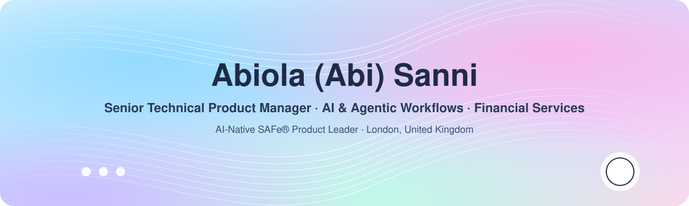

**Product Leader | Senior Technical Product Manager | Product Owner | AI & Agentic Workflows | Financial Services | AI‑Native SAFe®**

📍 London Area, United Kingdom &nbsp;·&nbsp; 🏢 Columbia Threadneedle Investments

---

## About

Technical Product Manager with 10+ years in financial services (asset management, ratings, regulation and private credit) and a Chemical Engineering with Business Management background.

I don't come from a coding background. I build with AI: Claude Code, Lovable, Streamlit and public APIs are my toolkit, and this profile is where I ship the things I build. Goal: become a competent AI Product Builder, not just a PM who writes about AI.

---

## Projects

### 🔎 [Clario](https://github.com/abisanzz/clario) — KYC Document Intelligence Agent
AI‑assisted KYC document review for client onboarding, built for financial‑services KYC/AML operations teams. A Streamlit app that uses Claude alongside the **Companies House** and **FCA Register** APIs to read onboarding documents, check them against public records, and surface what an analyst needs to decide.
`Python` `Streamlit` `Claude API` `Companies House API` `FCA Register`

---

## Skills

| Product | AI | Ways of working |
|---|---|---|
| Technical product management · Product ownership · Roadmaps & discovery | Agentic workflows · LLM‑powered automation · Prompt design · Claude Code · AI prototyping | SAFe® Agile · Stakeholder management · Cross‑functional delivery |

**Certifications:** Salesforce · SAFe® Agile

---

## Education

**BEng Chemical Engineering with Business Management** · University of Birmingham

---

📬 Best way to reach me is on [LinkedIn](https://www.linkedin.com/in/abiolasanni).

